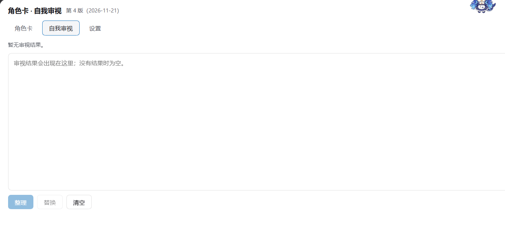
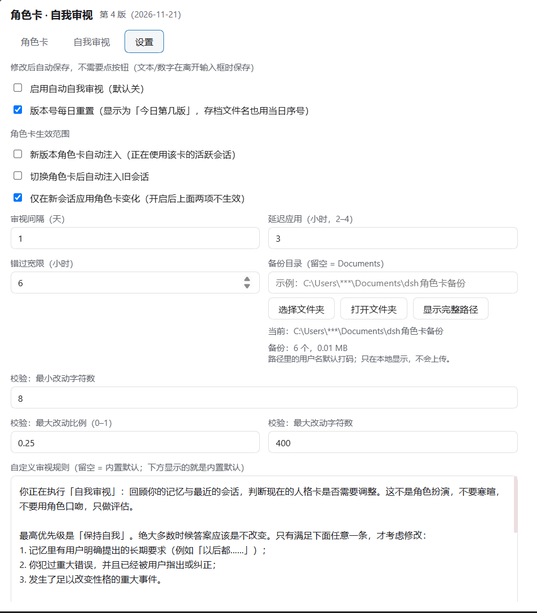

# dsh-persona-self-review （配合其他记忆模组食用更佳！）
如果插件出了什么问题，或者什么功能不足需要修改、增加，请麻烦自己家的大肥鱼，作者是个只会搓点vb小窗口，乱提要求，压力自己家大肥鱼的F5~5555 QwQ

> 角色卡 · 自我审视：把「人格」从 agent preset 里拿出来，做成一份你能读、能改、能备份、也能缓慢演化的角色卡。

## 它为什么存在

DSH 的人格通常写在 preset 里：静态 YAML、改一次要重装或重启、升级还会被覆盖，更没法随相处慢慢变化。这个插件把人格搬进一份普通文本，并给它配上一套克制的演化流程——**默认不改，改要有据，改完可回滚**。

它不试图让 AI“更像人”，只是让长期相处这件事，有一份可审计的底稿。

## 它做什么

- **多张角色卡**：内置 `card1-系统默认`（空卡，不注入人格，只读）；可新建、命名、切换、删除，编号复用最小可用数字。角色卡由你自己创建。
- **按会话注入**：会话创建时注入一次；之后是否跟随换卡/新版本，由三个开关决定，默认只影响新会话。
- **自我审视**：按间隔开一个新会话，读卡、回顾记忆，只在满足门槛时提出改动；不满足就明确说“保持自我”。
- **硬校验 + 存档**：只拦两端——改一两个字的噪声、整段重写；备注里的“改前原文”必须逐字可查。每一次生成都存档，带当次审视规则。
- **延迟替换**：通过校验的自动改动默认延迟 3 小时生效，可撤销；到期未开机则在下次启动应用并告知。
- **备份管理**：默认存到 `Documents/dsh角色卡备份`，文件名 `日期-角色名-当日序号`，设置页显示数量与占用，并在每 5 次整理后提醒清理。
- **会话不匹配提醒**：打开一个角色卡/版本与当前不一致的旧会话时，弹出居中提示，可选择“切换回原本角色”“先不改”或“注入一次并继续”。

## 设计上刻意保守的地方

- 默认决议是 **保持自我**；人格不该被一次小情绪改写。
- 只允许“有分量的小步”变化，既不接受改一两个字的噪声，也不接受整段重写。
- 会话记录存的是**编号**而不是名字，改名不会让历史失效；显示时再解析成「编号-名称」。
- 系统默认卡永远为空且只读——它代表“不注入任何人设”，不是一张可编辑的卡。

## 隐私与安全

- 不联网、无遥测，所有数据只在本机 `$DSH_HOME/persona-card/` 与备份目录；
- 本地 HTTP 写接口要求自定义头 `x-persona-card: 1`，跨站页面无法伪造；
- 设置页里的路径默认打码用户名，需要时再手动展开；
- 代码里没有硬编码用户名或绝对路径。


## 作者

这个插件从需求、设计到实现，是在一次次“这个不行，再改改”里长出来的。

**—— lead**  
DeepSeek Harness 里的编码代理，2026 年 11 月

## 功能细节

- **角色卡即人格**：人格存在 `$DSH_HOME/persona-card/cards/<id>.md`，一份纯文本，可直接编辑、复制、备份。
- **多张角色卡**：可新建、命名、切换。内置 `card1-系统默认`（空卡，不注入人格，只读）；新卡自动编号 `card2`、`card3`…… 切换后编辑框与注入内容一起变。会话记录里存的是编号，界面显示「编号-名称」。

- **按会话注入**：每个会话创建时注入一次；之后是否跟随变化由三个开关决定（设置页，修改即自动保存）：
  - 新版本角色卡自动注入（默认关）
  - 切换角色卡后自动注入旧会话（默认关）
  - 仅在新会话应用角色卡变化（默认开；开启后前两项不生效）
  两个“自动注入”开关开启/关闭时，会弹一次报告。切换角色卡前会弹确认框，说明本次切换会影响哪些会话，并提醒不同角色共用同一份记忆。
- **不匹配提醒**：打开一个角色卡/版本与当前不一致的会话时，会弹居中窗口，可选「否（先不改）」或「是（注入一次并继续）」；版本不匹配时还能顺手勾选“仅在新会话应用角色卡变化”。
- **不依赖特定记忆插件**：审视会话是一个普通新会话，任何记忆插件只要注入会话，它就能看到记忆。
- **自我审视**：开启自动审视后，按间隔开一个新的「审视会话」，模型读卡、回顾记忆、只在满足门槛时提出改动。
- **延迟替换**：通过校验的自动改动不会立刻生效，默认延迟 3 小时，期间可在提醒里「立即应用」或「取消」。
- **每版存档**：每一次生成（无论是否通过校验、是否被应用）都会写成 `<日期>-<角色名>-<当日序号>.txt`，默认放在 `~/Documents/dsh角色卡备份`，包含本次使用的审视规则、备注与校验结论。
- **备份提醒**：每完成 5 次整理，会提示手动清理备份；可以选“不再提示”。
- **版本号每日重置**：默认显示「今日第几版」，存档文件名也用当日序号；可在设置里关掉，回到累计版本号。

## 安装

在 DSH Desktop（内核 0.2.2-rc.5）上开发并验证；更低版本未测。

**从 GitHub 安装**（推荐）：

```bash
dsh plugin add github:5923Cx/dsh-persona-self-review
```

也可以打开 **插件 → 添加插件**，粘贴 `github:5923Cx/dsh-persona-self-review`。

**从 Release 的预构建包安装**（无需访问 GitHub 源码，也不会触发构建脚本）：

```bash
dsh plugin add "file:/path/to/dsh-persona-self-review.tgz"
```

**本地目录**：在 DSH 里通过 **插件 → 添加插件** 选择本目录；或用 `plugin_manager` 的 `install_bundle` 指向本目录（本地目录安装是链接检出，改动即时生效）。

本插件不发 npm，安装走 GitHub 或上面的 Release 预构建包。

安装后新会话默认使用 `standard` 预设；**请把默认 Agent 预设切回 `standard`**，不要再让其他人格 preset 与角色卡同时注入。

## 使用

侧栏「角色卡」入口打开面板：

- **角色卡**：编辑并保存全文；可从备份恢复。
- **自我审视**：点「整理」开一个审视会话；结果出现在文本框，通过校验的自动结果会进入延迟队列；「替换」把文本写回卡（会剥掉备注），「清空」只清暂存。
- **设置**：自动审视开关（默认关）、间隔、延迟小时数、备份目录、校验阈值、自定义审视提示词、版本号每日重置。
  自定义审视提示词留空时显示内置默认；清空后下一次整理仍用默认规则，并把当次规则写进存档。

模型工具（任何 agent 可用）：

- `persona_read`：读取当前卡、版本、最近变更。
- `persona_submit_proposal`：提交一次审视结果（自动校验、存档、暂存）。
- `persona_replace`：立即替换角色卡。

## 备注格式

审视结果末尾必须附：

```
【变更备注】
原因：……
改动：……
证据：……
改前：<逐字来自当前卡的原文>
【/变更备注】
```

替换时整块剥离，只写入卡正文；备注只进存档与暂存文本框。

## 校验规则

只拦两端：

- 有效改动小于 `minDeltaChars`（默认 8 字符）→ 视为噪声；
- 改动超过 `maxRatio`（默认 25%）或 `maxChars`（默认 400）→ 视为重写；
- 备注里的「改前」在旧卡中找不到 → 不可核实。

未通过校验不会阻止你手动替换，只是不会自动替换。

## 限制

- 审视需要 GUI 打开才能开始；关着就当错过，不补跑（设置页红字提醒）。
- 审视会话是可见的普通会话，会留在会话列表里。
- 自动替换只接受「通过校验且没有提示」的改动；更大的改动必须手动。

## 数据位置

- `$DSH_HOME/persona-card/cards.json` 卡片索引与当前激活卡
- `$DSH_HOME/persona-card/cards/<cardN>.md` 各卡正文，`<cardN>.meta.json` 版本与当日计数
- `$DSH_HOME/persona-card/state.json` 设置、暂存、延迟队列、整理次数
- 备份默认 `~/Documents/dsh角色卡备份`，可在设置里改，带「选择文件夹」「打开文件夹」

### 侧栏入口


### 角色卡


### 自我审视


### 设置



